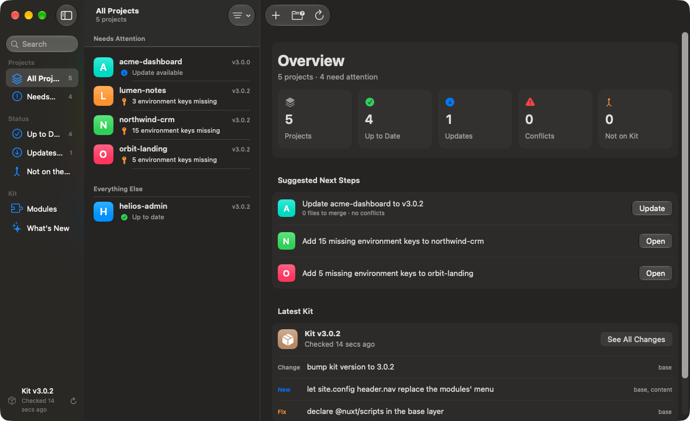
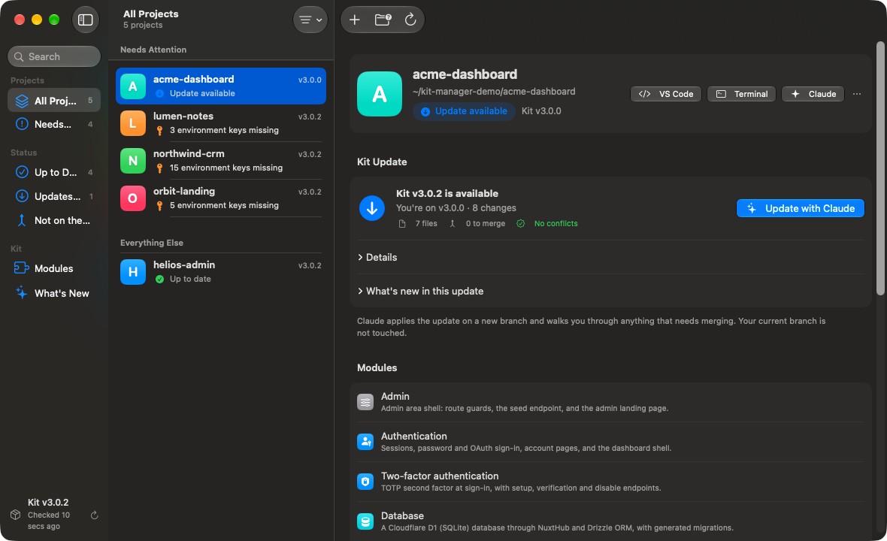
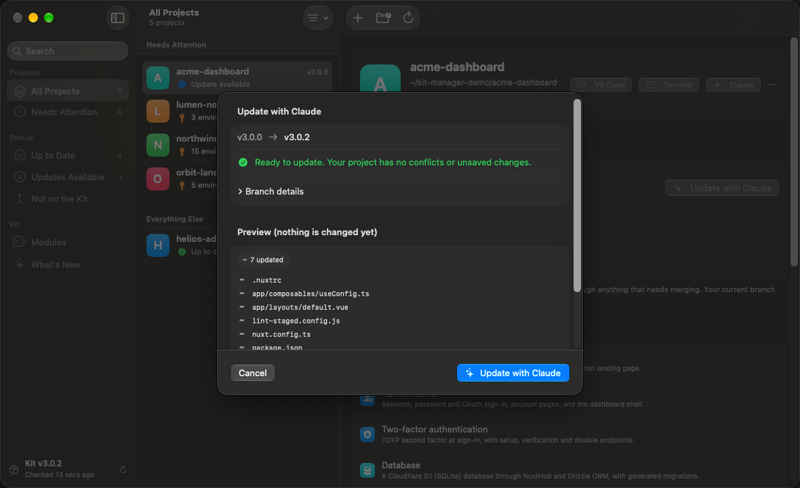
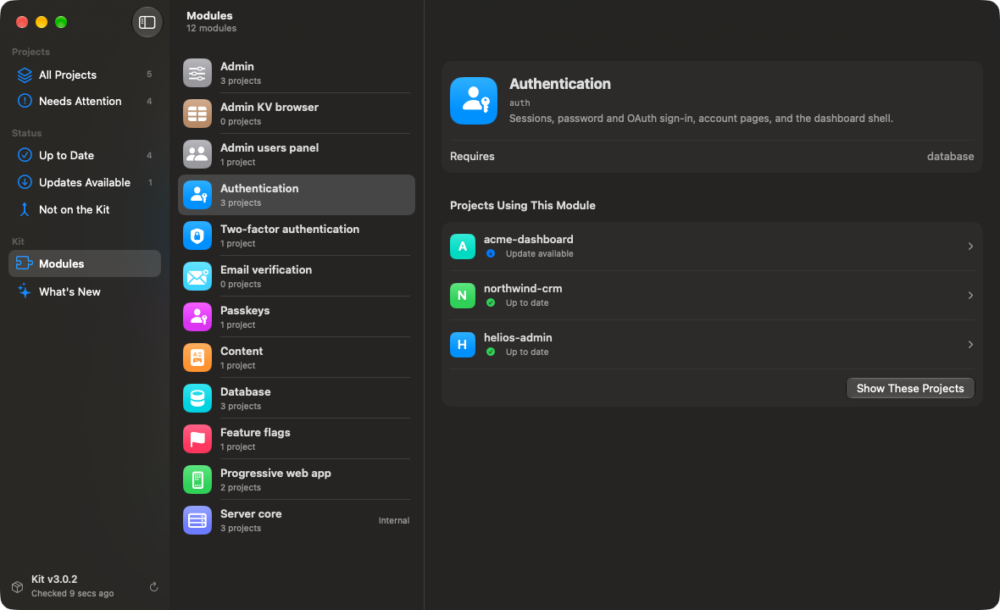
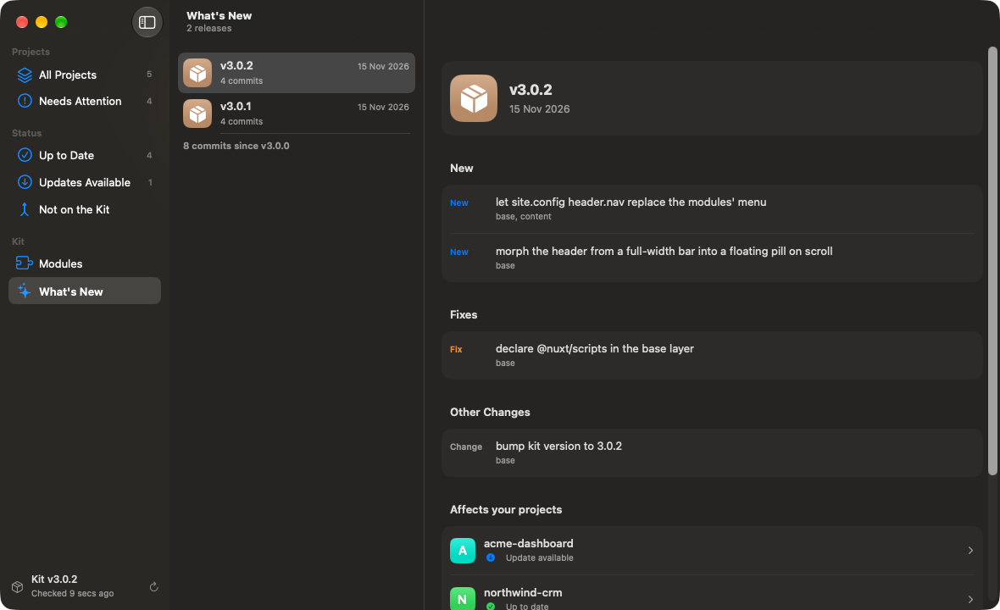
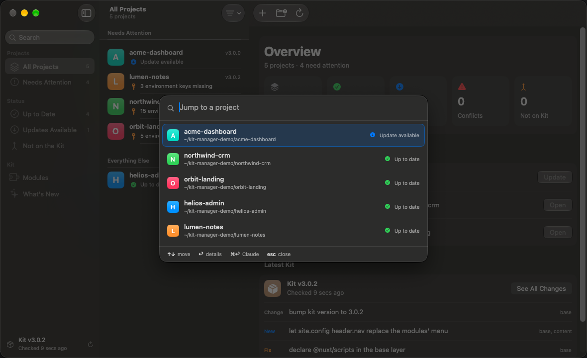

# Nuxt SaaS Starter Kit

https://nnsvn.me/products/nuxt-starter-kit

Fully equipped Technical Starter Pack for busy Nuxters.

A comprehensive, production-ready SaaS starter kit built with Nuxt 4, featuring authentication, admin dashboard, AI integration, and modern UI components. This project is designed to kickstart your web development journey using a modern stack of technologies, making it easier to create powerful and feature-rich applications.


## ✨ Features

### 🔐 Authentication & User Management

- **nuxt-auth-utils** - Modern authentication system
- Google OAuth integration
- Session management with database persistence
- User profile management
- Passwordless authentication with WebAuthn/Passkeys

### 🎨 Modern UI/UX

- **Tailwind CSS v4** - Latest utility-first styling
- **shadcn/ui** components - Accessible, customizable
- **Reka UI** primitives - Unstyled, accessible components
- Dark/light theme support with smooth transitions
- Responsive design with mobile-first approach
- Loading skeletons and optimistic UI updates

### 🗄️ Database & Storage

- **Drizzle ORM** - Type-safe database toolkit
- **Cloudflare R2** - Scalable file storage with zero egress fees
- Database migrations with Drizzle Kit

### 🎯 SEO

- Pre-configured SEO with `@nuxtjs/seo`
- Dynamic meta tags and Open Graph support
- Sitemap generation
- Robots.txt configuration

### 📱 PWA Features

- Auto-update service worker
- Offline caching with Workbox
- App manifest with shortcuts
- Install prompts
- Asset generation via `@vite-pwa/assets-generator`

### Content

- Blog and documentation system with `@nuxt/content`
- Markdown support with custom components
- SEO-friendly content structure
- Multi-language support with locale-based content

## 📦 Tech Stack

- **Framework**: Nuxt 4 with Vue 3
- **Language**: TypeScript with strict mode
- **Styling**: Tailwind CSS v4 + shadcn-vue
- **Database**: Sqlite + Drizzle ORM
- **Authentication**: nuxt-auth-utils + SimpleWebAuthn
- **Storage**: Cloudflare R2
- **Analytics**: Sentry
- **Deployment**: Nuxthub -> Cloudflare (recommended) / Vercel / Netlify ...

## 🚀 Getting Started

### Prerequisites

- Node.js 26.x or higher
- pnpm 12.14.0

### Create a project

```bash
npm create nuxt-saas@latest my-app
```

Select the modules you need. Add `bot-protection` to enable Turnstile on public forms, or register your own verification provider. Base is always included; each selected feature lives in
`layers/<id>/` and its dependencies are included automatically. To create a base-only project
without prompts, pass `-- --yes`; to select modules explicitly, use:

```bash
npm create nuxt-saas@latest my-app -- --yes --modules auth-password,pwa
```

The generated app uses pnpm (Node.js 22+ for the CLI).

The [CLI README](packages/create-nuxt-saas/README.md) covers all commands, upgrade/conflict handling
and module authoring. Projects created with CLI 2.x must be regenerated, not upgraded to 3.0.

### Work on the full kit

Cloning this repository includes every layer:

```bash
git clone https://github.com/No-Name-Studio-VN/Nuxt-Starter-Kit.git
cd Nuxt-Starter-Kit
```

1. Enter the repository as shown above.

2. Install dependencies:

```bash
pnpm install
```

The repository uses a pnpm workspace and a shared `pnpm-lock.yaml`. CI installs
with `pnpm install --frozen-lockfile`. Tailwind's Nuxt module and VeeValidate stay
on their newer prereleases; their `latest` tags still point to older majors.
TypeScript uses the latest TypeScript 6 compatibility package because NuxtHub's
schema generation requires the compiler API that TypeScript 7 no longer provides.

3. Set up environment variables:

```bash
cp .env.example .env
```

Fill in the required environment variables in the `.env` file.

4. Generate database migrations:

```bash
pnpm run db:generate
```

5. Start the development server:

```bash
pnpm run dev
```

The app will be available at `http://localhost:3000`.

## 📁 Project Structure

```text
Nuxt-Starter-Kit/
├── app/                   # Base UI, pages, plugins and extension registries
├── i18n/                  # Generic base translations
├── public/                # Base static assets
├── server/                # Base deployment support; kit-only migrations
├── shared/                # Base shared constants and validation schemas
├── types/                 # Base types and augmentable extension interfaces
├── layers/
│   ├── auth/              # module.json, Nuxt config, app, server, schemas, types
│   ├── database/          # Database infrastructure
│   ├── content/           # Docs/blog configuration and UI
│   └── ...                # Other optional modules
├── content/               # Root Markdown, included only with content
├── packages/create-nuxt-saas/ # CLI (not copied into generated projects)
├── packages/kit-manager-macos/ # Kit Manager macOS app (not copied into generated projects)
└── nuxt.config.ts         # Base config; Nuxt auto-registers selected layers
```

Generated projects contain only base and selected layers. Database migrations are not copied;
run `pnpm db:generate` for the selected schemas. Keep `.nuxt-saas.json` in version control:
add/remove use its recorded kit commit, while upgrade moves to a new commit.

```bash
pnpm dlx create-nuxt-saas@latest add auth-password
pnpm dlx create-nuxt-saas@latest upgrade --check
pnpm dlx create-nuxt-saas@latest upgrade
```

Apply commands require a clean git tree. Review the preview and follow the printed install,
environment and migration steps.

## 🖥️ Kit Manager for macOS

Kit Manager is a native macOS app for everyone running more than one project from this kit. It
shows which kit version each project is on, what an upgrade would change, which modules each
project uses and what is missing from its environment, and hands the work to Terminal, VS Code or
Claude.



|                                                                               |                                                                                                     |
| ----------------------------------------------------------------------------- | --------------------------------------------------------------------------------------------------- |
|      |                       |
| **Project detail:** kit update, modules, customisation and health in one page | **Update with Claude:** preview the file plan before anything changes, then upgrade on a new branch |
|            |                              |
| **Modules:** every kit module and the projects that use it                    | **What's New:** kit releases and the projects each one affects                                      |

Press ⌘K for the quick switcher, and use the menu bar item to see at a glance which projects need
attention.



The app **reads, the CLI acts**: anything that changes a project runs through `create-nuxt-saas`
after an explicit click. It needs macOS 26 or later. Download `KitManager.zip` from the
[latest release](https://github.com/No-Name-Studio-VN/Nuxt-Starter-Kit/releases/latest), or build
it from source with Xcode; see the [Kit Manager README](packages/kit-manager-macos/README.md).

## ☁️ Deployment

This template uses [NuxtHub](https://hub.nuxt.com/) version 0.10x, which allows deploying to multiple providers. We recommend deploying to Cloudflare for best performance and zero egress fees, but you can also deploy to Vercel or Netlify.

Follow the [NuxtHub deployment guide](https://hub.nuxt.com/docs/getting-started/deploy) to host a full-stack Nuxt application with minimal configuration.

## 📄 License

This project is open source and available under the [MIT License](LICENSE).

## 🚀 Contributing

We welcome contributions from the community! If you encounter any issues or have suggestions for improvements, feel free to open an issue or submit a pull request on the repository.

## 👥 Author

**No Name Studio**
📧 contact@nnsvn.me
