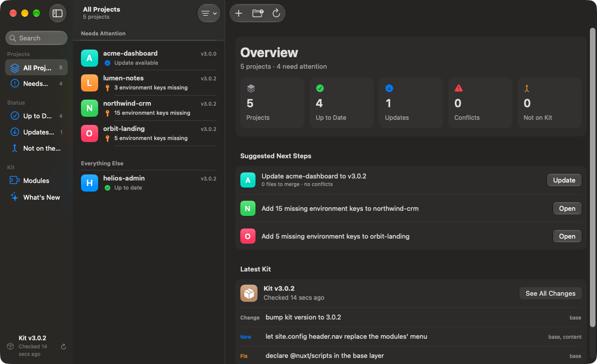
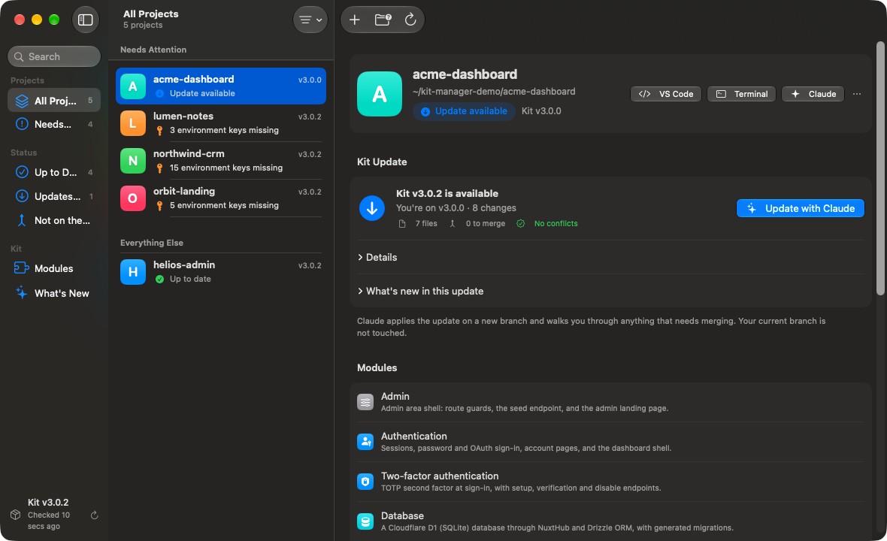
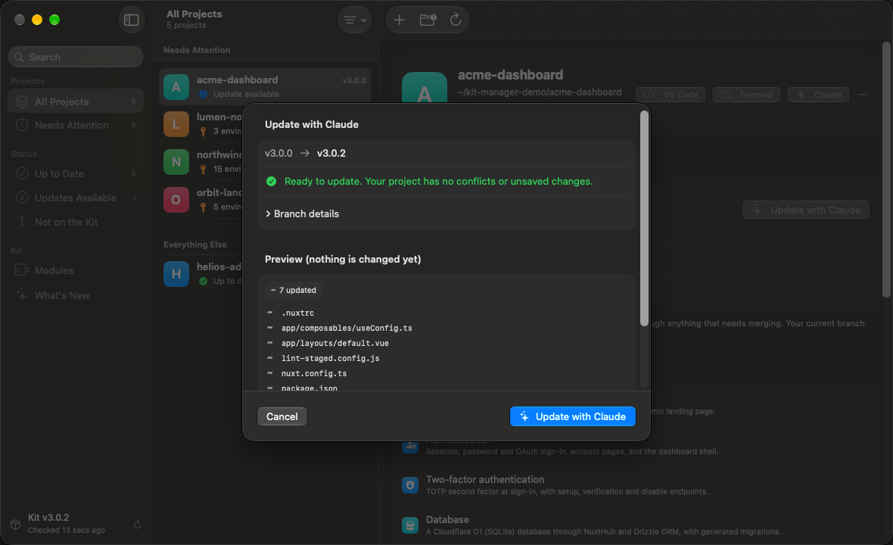
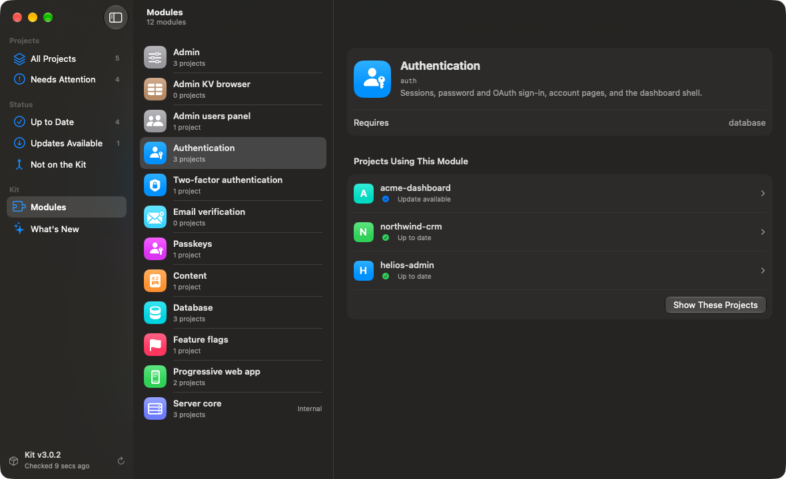
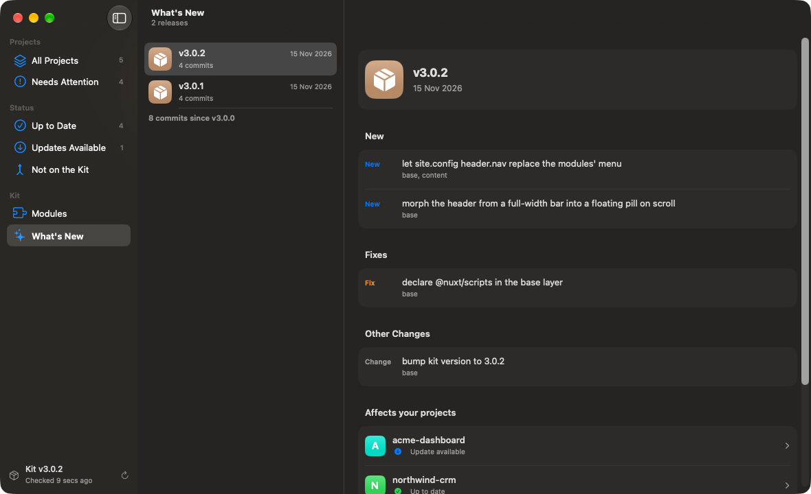

# Kit Manager (macOS)

A native macOS app for managing projects generated from the Nuxt Starter Kit: see which kit version each project is on, review upgrade and migration state, and hand work off to Terminal, VS Code or Claude.

The app **reads, the CLI acts**. Anything that changes a project (upgrade, migration, module changes) is performed by `create-nuxt-saas`; the app only inspects state and launches the CLI after an explicit click.



|                                                |                                                     |
| ---------------------------------------------- | --------------------------------------------------- |
|  |  |
|        |         |

## Install from a release

1. Download `KitManager.dmg` from the [latest kit release](https://github.com/No-Name-Studio-VN/Nuxt-Starter-Kit/releases/latest).
2. Open the disk image and drag **KitManager.app** to the **Applications** shortcut. Eject the disk image and open Kit Manager from Applications.
3. The app is ad-hoc signed and not notarized. If macOS blocks the first launch and you trust the download, open **System Settings → Privacy & Security**, click **Open Anyway**, and confirm.

The disk image contains a universal app for Apple silicon and Intel Macs running macOS 26 or later. It still needs a local kit checkout with the CLI built (see [Requirements](#requirements), minus Xcode). Set the checkout path in Kit Manager’s Settings.

## Requirements

- macOS 26 or later
- Xcode 27 or later
- Node 22 or later and pnpm
- The built CLI: run `pnpm --dir packages/create-nuxt-saas build` from the repository root. The app uses the CLI built in the configured kit checkout (it looks for `dist/cli.mjs`) and requires CLI 3.2.0 or later for upgrade safety previews, backups, and decisions.

## Layout

- `KitManager.xcodeproj` and `KitManager/`: the thin SwiftUI app target.
- `KitManagerCore/`: a local Swift package holding all testable logic (process layer, CLI client, project inspection, kit git history, launching).

Files added under `KitManager/` join the app target automatically.

## Open, build, run

```sh
open packages/kit-manager-macos/KitManager.xcodeproj
```

Pick the `KitManager` scheme and press Run, or build from the terminal:

```sh
xcodebuild -project packages/kit-manager-macos/KitManager.xcodeproj -scheme KitManager -configuration Debug build
```

The app is signed ad hoc and is not sandboxed, because it launches `node`, `git` and `claude` from your shell environment.

## Using the app

- **Kit path:** Settings (⌘,) holds the path to your Nuxt-Starter-Kit checkout. It defaults to `~/Documents/GitHub/Nuxt-Starter-Kit` when that folder exists. Upgrade previews, version labels, the kit changelog and the module list all come from this checkout, and the app fetches it every 30 minutes by default (adjustable in Settings).
- **Menu bar extra:** a menu bar item shows how many projects need attention and lists them, with quick actions and a way back to the main window.
- **Quick switcher:** ⌘K opens the quick switcher over all projects. ⌘R refreshes every project.

## Permissions

The app is not sandboxed, but macOS still asks for the Documents folder permission when the kit or your projects live under `~/Documents`. Because the app is ad-hoc signed, every rebuild has a new signature and macOS asks again. Signing with a stable Apple Development identity (Signing & Capabilities, then Team) avoids the repeat prompts.

## Tests

```sh
swift test --package-path packages/kit-manager-macos/KitManagerCore
```

With Xcode selected, run the packaging smoke test from the repository root:

```sh
packages/kit-manager-macos/scripts/test-build-dmg.sh
```
